# Entity Relationship Diagram

## Diagram

```mermaid
erDiagram
  User ||--o{ UserInteraction : has
  User ||--o{ ImportSource : configures
  User ||--o{ RecommendationList : owns
  User ||--o{ RecommendationEvent : receives
  Item ||--o{ ItemExternalRef : mapped_by
  Item ||--o{ ExternalId : links_to
  Item ||--o{ UserInteraction : receives
  Item ||--o{ RecommendationEvent : appears_in
  Item ||--o{ SimilarityEdge : similar_to
  ImportSource ||--o{ ImportJob : runs
  RecommendationList ||--o{ RecommendationEvent : contains
  User ||--o{ UserItemState : tracks
  User ||--o{ UserItemStateHistory : logs
  User ||--o{ SavedCollection : curates
  Item ||--o{ UserItemState : stated_in
  SavedCollection ||--o{ SavedCollectionItem : contains
  Item ||--o{ SavedCollectionItem : listed_in
  Item ||--o{ ItemAlias : known_as
  Item ||--o{ ItemCreator : credited
  Creator ||--o{ ItemCreator : creates
  Series ||--o{ SeriesItem : groups
  Item ||--o{ SeriesItem : part_of
  Item ||--o{ ItemTag : tagged
  CanonicalTag ||--o{ ItemTag : applied_to
  User {
    uuid id PK
    string email
    string username
    jsonb enabled_media_types
    jsonb preferences
    bool onboarding_complete
  }
  Item {
    uuid id PK
    enum media_type
    string title
    string series
    jsonb genres
    jsonb tags
    jsonb creators
    int release_year
    float popularity
    bool is_anchor
    jsonb extensions
  }
  ItemExternalRef {
    uuid id PK
    uuid item_id FK
    string source
    string external_id
  }
  ExternalId {
    uuid id PK
    uuid item_id FK
    enum media_type
    string provider
    string external_key
    text external_url
    float confidence
    string resolution_method
  }
  Creator {
    uuid id PK
    string name
    string normalized_name
    string kind
  }
  ItemCreator {
    uuid item_id FK
    uuid creator_id FK
    string role
    int sort_order
  }
  Series {
    uuid id PK
    enum media_type
    string name
    string normalized_name
    string franchise
  }
  SeriesItem {
    uuid series_id FK
    uuid item_id FK
    float sequence
  }
  ItemAlias {
    uuid id PK
    uuid item_id FK
    string alias
    string normalized_alias
    string source
  }
  CanonicalTag {
    uuid id PK
    string slug
    string label
    string category
  }
  ItemTag {
    uuid item_id FK
    uuid tag_id FK
    float weight
  }
  UserInteraction {
    uuid id PK
    uuid user_id FK
    uuid item_id FK
    enum interaction_type
    float value
    enum source
    float confidence
    enum context
    timestamptz timestamp
  }
  RecommendationList {
    uuid id PK
    uuid user_id FK
    string feed_key
    string title
  }
  RecommendationEvent {
    uuid id PK
    uuid user_id FK
    uuid item_id FK
    string feed_key
    float score
    int rank
    jsonb factors
    string explanation
    string action_taken
  }
  ImportSource {
    uuid id PK
    uuid user_id FK
    string source
    string base_url
    text credentials_encrypted
  }
  ImportJob {
    uuid id PK
    uuid import_source_id FK
    enum status
    jsonb stats
    text error
  }
  EmbeddingVector {
    uuid id PK
    string entity_type
    uuid entity_id
    string model
    vector embedding
  }
  SimilarityEdge {
    uuid id PK
    uuid item_a_id FK
    uuid item_b_id FK
    string kind
    float score
  }
  ModelConfig {
    uuid id PK
    enum media_type
    string name
    jsonb weights
    bool active
  }
  UserItemState {
    uuid id PK
    uuid user_id FK
    uuid item_id FK
    enum media_type
    enum state
    enum source
    text notes
    int priority
  }
  UserItemStateHistory {
    uuid id PK
    uuid user_id FK
    uuid item_id FK
    enum old_state
    enum new_state
    string reason
  }
  SavedCollection {
    uuid id PK
    uuid user_id FK
    enum media_type
    string name
    bool is_default
  }
  SavedCollectionItem {
    uuid collection_id FK
    uuid item_id FK
    int sort_order
  }
```

## Notes

- `media_type`: `movie | tv | book | audiobook | comic | game`
- Default enabled media types: `movie, tv, audiobook, game` (books/comics opt-in)
- `interaction_type`: `rate | pass | save | consume | finish | dismiss` (behavioral event log)
- `item_state`: `interested | shortlisted | in_progress | completed | passed | hidden` (durable intent; one current row per user+item, changes appended to `user_item_state_history`)
- `interest_source`: `manual | imported | inferred`
- `external_ids` (Phase 3): outbound public-metadata links (IMDb/RT/Metacritic/TMDb/OpenLibrary/IGDB/…), distinct from `item_external_refs` (import-source provenance). `confidence`/`resolution_method` separate verified deep links from fuzzy search fallbacks; unique `(item_id, provider)`
- Metadata quality (Phase 4): `creators`/`series`/`canonical_tags` are canonical entities (unique on normalized name / `(media_type, normalized_name)` / `slug`); `item_creators`/`series_items`/`item_tags` are the link tables; `item_aliases` (unique `(item_id, normalized_alias)`) backs cross-source dedup. `Item.genres/tags/creators/series` JSONB stays as the engine's fast read cache
- `embeddings.embedding` is `vector(768)` for `nomic-embed-text` (Stage 6)
- `recommendation_events.factors` always stores structured score components and `reasons[]`
- Dedup path: `item_external_refs(source, external_id)` unique, then title/year/media_type fuzzy match
