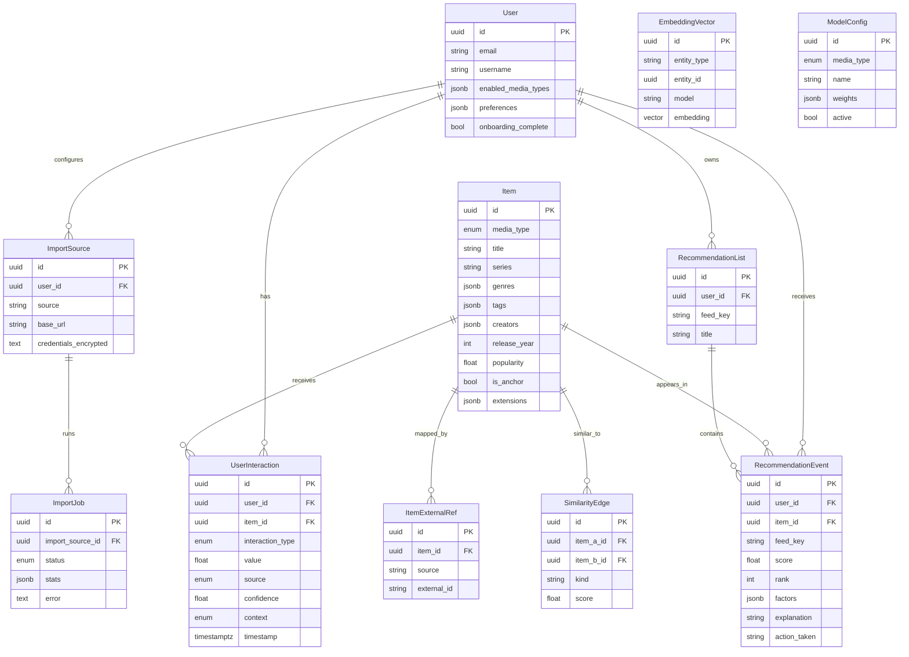

# Entity Relationship Diagram

## Diagram

## Notes

- `media_type`: `movie | tv | book | audiobook | comic | game`
- `interaction_type`: `rate | pass | save | consume | finish | dismiss`
- `embeddings.embedding` is `vector(768)` for `nomic-embed-text` (Stage 6)
- `recommendation_events.factors` always stores structured score components and `reasons[]`
- Dedup path: `item_external_refs(source, external_id)` unique, then title/year/media_type fuzzy match
