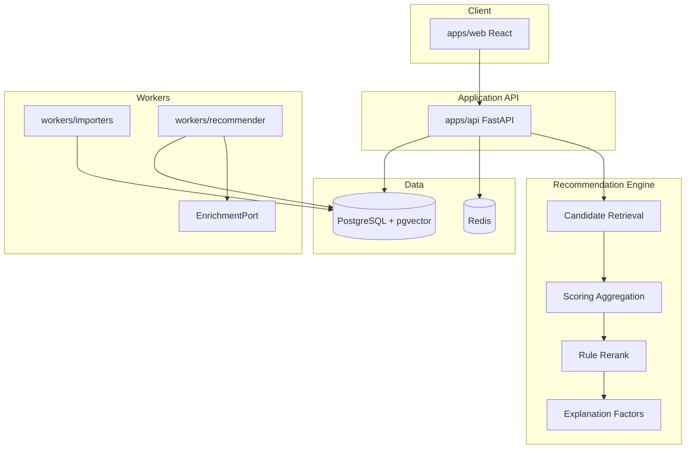

# Architecture Overview

Local-first hybrid media recommendation engine. Deterministic retrieval and ranking are authoritative; Ollama enrichment is optional and never decides scores.

## Four layers



| Layer | Responsibility |
|-------|----------------|
| Client | Per-domain shell (feeds/browse/saved/series/admin), item detail, interest states, source links — Singularity design system |
| API | JWT auth, per-domain catalog/recommendations/interest/collections/links, admin metrics |
| Engine | Collaborative + content + popularity + novelty + interest + serendipity/availability, layered candidate gen, franchise/creator rerank, structured explanations |
| Connectors | Jellyfin, Plex, Audiobookshelf, Trakt, TMDB harvest, Komga stub, CSV |

## UI / design

The web app follows the shared **Singularity Solutions design system** (`ui/singularity/tokens.css`, vendored to `apps/web/src/singularity-tokens.css`): blueprint-grid canvas, green `--sss-cta` for actions, cyan `--sss-icon-cyan` reserved for the brand glyph, light/dark via `[data-theme]`. See the `singularity-design-system` memory.

## Hard boundaries

1. **Ranking never calls Ollama.** `EnrichmentPort` may add embeddings, tags, or prose; `score` is computed only from collaborative / content / embedding / popularity / novelty / diversity / penalties with configurable weights.
2. **Pass is not dislike.** Pass applies a temporary suppression (`recent_pass_penalty` + cooldown TTL). Items may resurface on the `pass_resurface` feed after cooldown.
3. **Source-of-truth split.** External servers own consumption/progress. This app owns pass, save, rate, rerank preferences, and explanation history.
4. **One pipeline, per-media-type scoring.** All six domains share the same code path, but each feed is scored over a **single** media type (a movie is never ranked against a book); `model_configs` tunes coefficients independently per media type.

## Scoring

```
score = a·collab + b·content + c·embedding + d·popularity
      + e·novelty + f·diversity + i·interest + j·serendipity + k·availability
      − g·seenPenalty − h·recentPassPenalty
```

Defaults: `collab=0.25` (deterministic co-occurrence CF, built nightly), `embedding=0`
(until Ollama embeddings exist). Candidate generation is layered
(popularity/trending + collaborative expansion); rerank caps franchise and creator
concentration. See `roadmap.md` and `api-contract.md` for the full Phase 1–5 detail.

## Rating map

| Label | Weight |
|-------|--------|
| Loved it | 2.0 |
| Liked it | 1.0 |
| Meh | 0.0 |
| Disliked it | -1.0 |
| Hated it | -2.0 |

## Interaction signals

| Type | Training role (v1) |
|------|--------------------|
| rate | Strong explicit signal |
| consume / finish | Implicit positive (finish stronger) |
| save | Weak positive |
| pass | Suppress only — not negative |
| dismiss | Soft negative with decay when repeated |

## Deployment

`infra/docker-compose.yml` runs Postgres (pgvector), Redis, API, importer worker, recommender worker, and web. Ollama is optional and commented out until Stage 6.
