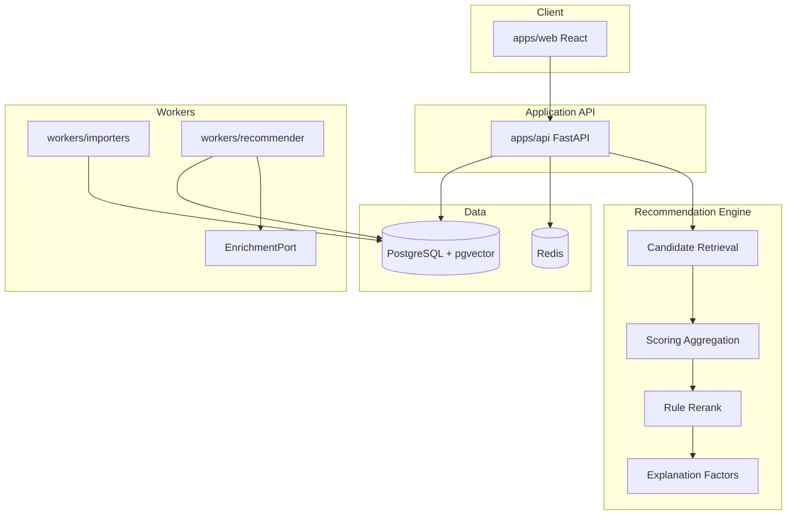

# Architecture Overview

Local-first hybrid media recommendation engine. Deterministic retrieval and ranking are authoritative; Ollama enrichment is optional and never decides scores.

## Four layers



| Layer | Responsibility |
|-------|----------------|
| Client | Auth UI, onboarding ratings, feeds, pass/save/rate actions |
| API | JWT auth, catalog, interactions, imports, recommendation endpoints |
| Engine | Popularity + metadata similarity + rule rerank + stored explanations |
| Connectors | Jellyfin, Plex, Audiobookshelf, Komga stub, Trakt stub, CSV |

## Hard boundaries

1. **Ranking never calls Ollama.** `EnrichmentPort` may add embeddings, tags, or prose; `score` is computed only from collaborative / content / embedding / popularity / novelty / diversity / penalties with configurable weights.
2. **Pass is not dislike.** Pass applies a temporary suppression (`recent_pass_penalty` + cooldown TTL). Items may resurface on the `pass_resurface` feed after cooldown.
3. **Source-of-truth split.** External servers own consumption/progress. This app owns pass, save, rate, rerank preferences, and explanation history.
4. **One engine, per-media-type weights.** Movies, TV, books, audiobooks, comics, and games share the same pipeline; `model_configs` tunes coefficients.

## Scoring (v1)

```
score = a·collab + b·content + c·embedding + d·popularity
      + e·novelty + f·diversity
      − g·seenPenalty − h·recentPassPenalty
```

v1 defaults: `a=0`, `c=0`. Content + popularity + novelty + diversity drive ranking.

## Rating map

| Label | Weight |
|-------|--------|
| Loved it | 2.0 |
| Liked it | 1.0 |
| Meh | 0.0 |
| Disliked it | -1.0 |
| Hated it | -2.0 |

## Interaction signals

| Type | Training role (v1) |
|------|--------------------|
| rate | Strong explicit signal |
| consume / finish | Implicit positive (finish stronger) |
| save | Weak positive |
| pass | Suppress only — not negative |
| dismiss | Soft negative with decay when repeated |

## Deployment

`infra/docker-compose.yml` runs Postgres (pgvector), Redis, API, importer worker, recommender worker, and web. Ollama is optional and commented out until Stage 6.
