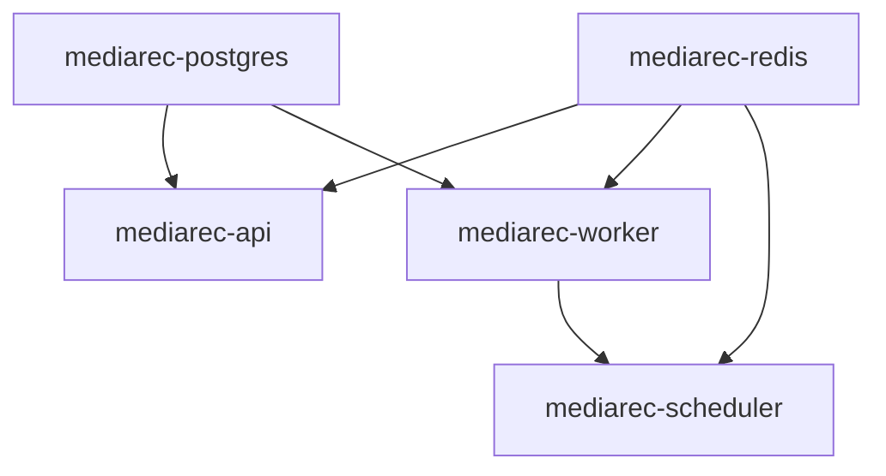

# Windows services map (WinSW)

Phase 6 service definitions for the native Windows runtime. Docker Compose remains
the supported developer path; these services are for the packaged installer.

Related:

- [`windows-layout.md`](windows-layout.md)
- [`redis-distribution.md`](redis-distribution.md)
- [`postgres-distribution.md`](postgres-distribution.md)
- [`python-runtime.md`](python-runtime.md)

---

## Service inventory

| Service id | XML | Process | Depends on | Start mode |
|------------|-----|---------|------------|------------|
| `mediarec-postgres` | [`installer/services/mediarec-postgres.xml`](../../installer/services/mediarec-postgres.xml) | `postgres.exe -D <PGDATA>` | — | Automatic |
| `mediarec-redis` | [`installer/services/mediarec-redis.xml`](../../installer/services/mediarec-redis.xml) | `redis-server.exe redis.conf` | — | Automatic |
| `mediarec-api` | [`installer/services/mediarec-api.xml`](../../installer/services/mediarec-api.xml) | `python -m app.launch api` | postgres, redis | Automatic (delayed) |
| `mediarec-worker` | [`installer/services/mediarec-worker.xml`](../../installer/services/mediarec-worker.xml) | `python -m app.launch worker --queues imports recommender` | postgres, redis | Automatic (delayed) |
| `mediarec-scheduler` | [`installer/services/mediarec-scheduler.xml`](../../installer/services/mediarec-scheduler.xml) | `python -m app.launch scheduler` | redis, worker | Automatic (delayed) |

All wrappers are **WinSW 2.x** (`WinSW-x64.exe`), staged as `runtime\winsw\mediarec-<name>.exe` beside a matching `.xml`.



---

## Failure recovery

Every service XML includes:

- `<onfailure action="restart">` with short backoff
- `<resetfailure>1 hour</resetfailure>`
- Rolled file logs under `%ProgramData%\MediaRecommendationEngine\logs\<service>\`

Postgres additionally allows a last-resort reboot action after repeated failures (conservative; can be removed if undesired for kiosk machines).

### Dependency readiness (Phase 6.2)

Windows SCM `<depend>` only orders **service start**, not application readiness. API / worker / scheduler also honor:

| Env | Default in services | Meaning |
|-----|---------------------|---------|
| `MEDIAREC_WAIT_DEPS_SECONDS` | `120` | Poll Postgres `SELECT 1` + Redis `PING` before serving / working |

Implemented in [`apps/api/app/launch.py`](../../apps/api/app/launch.py) (`wait_for_deps`). Local `scripts/dev.ps1` leaves this unset (no wait).

---

## Paths and placeholders

Installer / staging substitutes:

| Placeholder | Example |
|-------------|---------|
| `__INSTALLROOT__` | `C:\Program Files\Media Recommendation Engine` |
| `__PROGRAMDATA__` | `C:\ProgramData\MediaRecommendationEngine` |

`%BASE%` is the directory containing the WinSW exe (`runtime\winsw`).

Mutable state (data, redis dir, logs, `.env`) stays under ProgramData — see [`windows-layout.md`](windows-layout.md).

---

## Lifecycle commands

From an elevated shell, with cwd = `runtime\winsw` after staging:

```powershell
.\mediarec-postgres.exe install
.\mediarec-redis.exe install
.\mediarec-api.exe install
.\mediarec-worker.exe install
.\mediarec-scheduler.exe install

.\mediarec-postgres.exe start
.\mediarec-redis.exe start
.\mediarec-api.exe start
.\mediarec-worker.exe start
.\mediarec-scheduler.exe start

.\mediarec-api.exe status
.\mediarec-api.exe stop
.\mediarec-api.exe uninstall
```

Helper scripts:

| Script | Role |
|--------|------|
| [`scripts/package_winsw_services.ps1`](../../scripts/package_winsw_services.ps1) | Stage WinSW copies + substituted XMLs into `dist/native-windows/runtime/winsw` |
| [`scripts/Install-MediaRecServices.ps1`](../../scripts/Install-MediaRecServices.ps1) | install / start / stop / uninstall all (admin) |
| [`scripts/verify_winsw_services.ps1`](../../scripts/verify_winsw_services.ps1) | Validate XMLs + staged layout (no admin required) |

---

## Prerequisites before service start

1. `package_python_runtime.ps1`, `package_postgres_windows.ps1`, `package_redis_windows.ps1`, `package_winsw_services.ps1`
2. `Initialize-MediaRecDatabase.ps1` (creates PGDATA)
3. `Initialize-MediaRecRedis.ps1` (writes `redis\redis.conf`)
4. ProgramData `config\.env` with `DATABASE_URL`, `REDIS_URL`, `API_SECRET_KEY`, …

Migrations/seed should run at install time (or once via `python -m app.launch migrate|seed`) before relying on workers.

---

## Verification

```powershell
.\scripts\package_winsw_services.ps1
.\scripts\verify_winsw_services.ps1

# Elevated (optional full lifecycle smoke):
.\scripts\Install-MediaRecServices.ps1 -Action install
.\scripts\Install-MediaRecServices.ps1 -Action start
Get-Service mediarec-*
.\scripts\Install-MediaRecServices.ps1 -Action stop
.\scripts\Install-MediaRecServices.ps1 -Action uninstall
```

Expected:

- Five XMLs parse as XML; no remaining `__INSTALLROOT__` / `__PROGRAMDATA__` placeholders in the staged copies
- Each `mediarec-*.exe` exists beside its XML
- After install+start (admin), `Get-Service mediarec-*` shows Running; reboot returns services without manual sequencing (Phase 10 matrix)

---

## Unresolved risks

| Risk | Mitigation |
|------|------------|
| `postgres.exe` as WinSW child vs `pg_ctl` | Use foreground `postgres.exe -D`; ensure only one postmaster per PGDATA |
| MSYS Redis working directory | Confined to ProgramData `\redis` with relative conf (Phase 5) |
| Embed Python `._pth` | Already pins `app\api`, `app\packages`, `app` (Phase 3) |
| Admin required for SCM | Installer runs elevated; day-to-day users open the app URL only |
